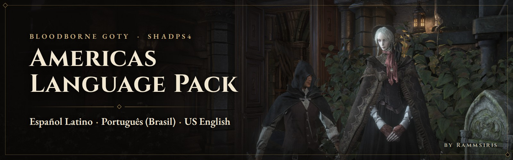
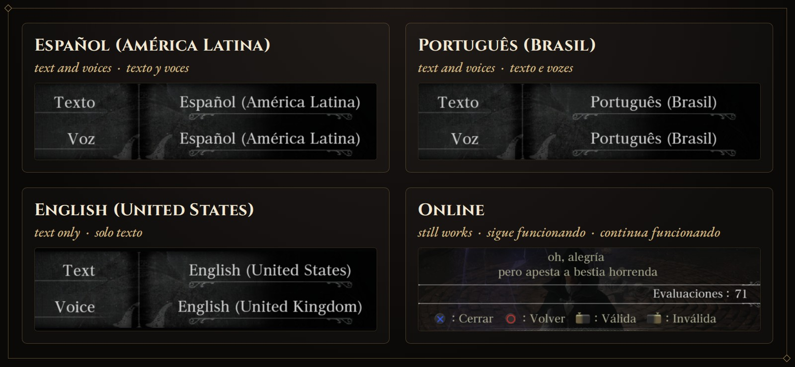
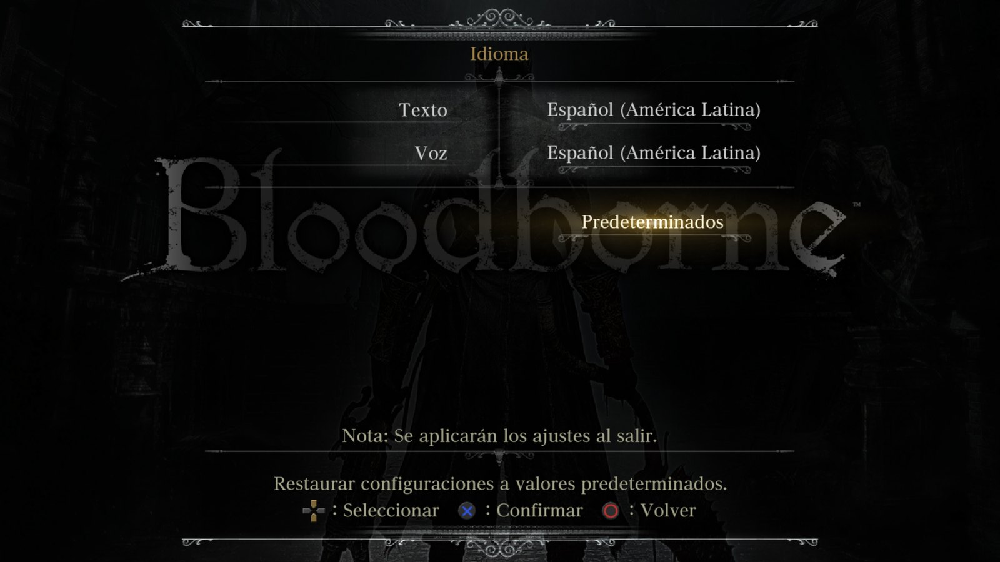
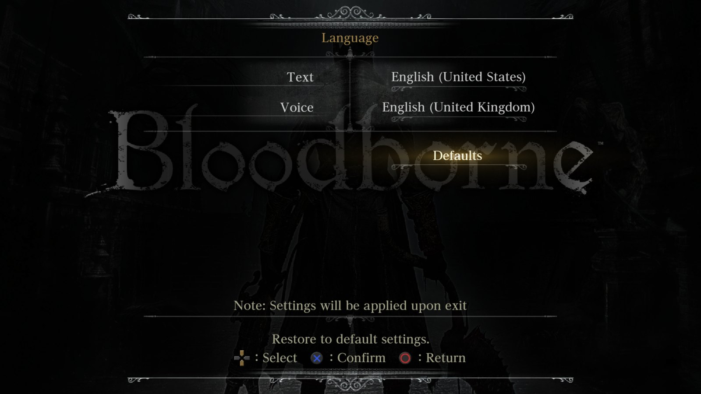
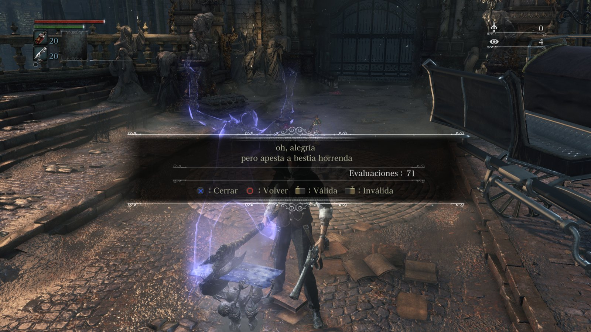

  

  <b>Bloodborne GOTY</b> (EU, CUSA03173) &nbsp;·&nbsp; <b>shadPS4 + BBLauncher</b> 
  Play in your language and keep online features: no <i>Unlock Game Region</i> patch needed. 
  Juega en tu idioma sin perder el online: no necesitas el parche <i>Unlock Game Region</i>. 
  Jogue com legendas e dublagem em português do Brasil sem perder o online.

  

  <a href="#english">English</a> &nbsp;·&nbsp; <a href="#español">Español</a> &nbsp;·&nbsp; <a href="../../releases">All versions / Todas las versiones</a> &nbsp;·&nbsp; <a href="https://www.nexusmods.com/bloodborne/mods/578">Nexus Mods</a>

  

📸 <b>Full screenshots</b> · Capturas completas

 
<table>
  <tr>
    <td></td>
    <td></td>
  </tr>
  <tr>
    <td></td>
    <td></td>
  </tr>
</table>

## English

The European GOTY already has the languages of the Americas, but its Language menu only shows the European ones. This pack adds them to the game's own menu **without touching the region**, so online play keeps working.

- 🌐 **Online keeps working:** no *Unlock Game Region* patch, so messages, bloodstains and specters stay on.
- 🎙️ **Text and voices** in Spanish (Latin America) and Portuguese (Brazil), **text** in US English.
- 🎮 **Real options in the Language menu,** with the game's official names. English (UK) and the other European languages stay.
- 📦 **No game files in the download:** the installer builds the mod from your own copy, and your game folder is never modified.

**Requirements:** Windows 10/11 · Bloodborne GOTY EU (CUSA03173) v1.09 dumped from your own copy, as a folder (not .zar) · shadPS4 + BBLauncher

### Install

1. Click **Download** above and extract the zip.
2. Drag the **Americas Language Pack v1.0** folder into your BBLauncher folder (the one with BB_Launcher.exe), not into Mods.
3. Open it and double-click **INSTALL - Americas Language Pack.bat** (keep the .ps1 next to it). Wait until it says **DONE** (or LISTO).
4. BBLauncher > Mod Manager > Inactive Mods > **Americas Language Pack** > Activate Mod.
5. In the game: OPTIONS > System > Language > pick your language in Text and in Voice.

> [!IMPORTANT]
> For online play keep the **Unlock Game Region** and **Disable HTTP Requests** patches OFF.

<b>Uninstall</b>

 

In the game, set Text and Voice back to "Default". Then BBLauncher > Mod Manager > Active Mods > Americas Language Pack > Deactivate Mod, and delete its folder from BBLauncher's Mods folder. Step by step in README.txt, section 8.

<b>Compatibility and known limitations</b>

 

- Works with patches and mods that don't change the game's text, font or voice files (60 FPS, resolution, graphics...).
- It doesn't work with other language or text mods: if BBLauncher shows "Mod conflict found", deactivate the other mod first.
- While the mod is active, Spanish (Latin America) takes the place of Italian, Portuguese (Brazil) of German, and English (United States) of Danish.
- US English is text only: for Voice keep English (United Kingdom), it's the same dub.
- "Default" doesn't pick the new languages: choose them yourself in Text and Voice.
- It also fixes two small mistakes in the official language names ("Pulir" instead of "Polaco" in Latin American Spanish, and "Brasil" in English).

<b>Safety and antivirus</b>

 

- **Official pages:** this GitHub page and the [Nexus Mods page](https://www.nexusmods.com/bloodborne/mods/578). Both have the same file. Don't download it from links posted by other people.
- Every release lists the zip's SHA-256 and its VirusTotal scan.
- The installer is plain-text PowerShell that anyone can read ([read it here](Americas%20Language%20Pack/Americas_Language_Pack.ps1)). It only reads your game files and BBLauncher's settings and writes the mod folder: no internet connections, no changes to Windows.
- Some antivirus programs (Bitdefender, for example) may flag it with a generic heuristic detection such as "Heur...Boxter", a common false positive for installers written as scripts. You don't need to turn off your protection: add an exception for the installer folder (README.txt, section 10).

📖 README.txt (inside the zip, English and Spanish) covers every step, installing without BBLauncher, troubleshooting and FAQ.

## Español

La GOTY europea ya trae los idiomas de América, pero su menú Idioma solo muestra los europeos. Este pack los agrega al menú del propio juego **sin tocar la región**, así que el online sigue funcionando.

- 🌐 **El online sigue funcionando:** sin el parche *Unlock Game Region*, así que los mensajes, las manchas de sangre y los espectros siguen ahí.
- 🎙️ **Texto y voces** en español (América Latina) y portugués (Brasil); **texto** en inglés de EE. UU.
- 🎮 **Opciones reales en el menú Idioma,** con los nombres oficiales del juego. El inglés (Reino Unido) y los demás idiomas europeos se quedan.
- 📦 **La descarga no trae archivos del juego:** el instalador crea el mod a partir de tu propia copia, y la carpeta de tu juego nunca se modifica.

**Requisitos:** Windows 10/11 · Bloodborne GOTY EU (CUSA03173) v1.09 dumpeado de tu propia copia, como carpeta (no .zar) · shadPS4 + BBLauncher

### Instalación

1. Dale clic a **Descargar** arriba y extrae el zip.
2. Arrastra la carpeta **Americas Language Pack v1.0** a tu carpeta de BBLauncher (la que tiene BB_Launcher.exe), no a Mods.
3. Ábrela y dale doble clic a **INSTALL - Americas Language Pack.bat** (deja el .ps1 junto). Espera a que diga **LISTO** (o DONE).
4. BBLauncher > Mod Manager > Inactive Mods > **Americas Language Pack** > Activate Mod.
5. En el juego: OPTIONS > Sistema > Idioma > elige tu idioma en Texto y en Voz.

> [!IMPORTANT]
> Para el online deja APAGADOS los parches **Unlock Game Region** y **Disable HTTP Requests**.

<b>Desinstalar</b>

 

En el juego regresa Texto y Voz a "Predeterminado". Luego BBLauncher > Mod Manager > Active Mods > Americas Language Pack > Deactivate Mod, y borra su carpeta de la carpeta Mods de BBLauncher. Paso a paso en el README.txt, sección 8.

<b>Compatibilidad y limitaciones conocidas</b>

 

- Funciona con parches y mods que no cambien los archivos de texto, fuentes o voces del juego (60 FPS, resolución, gráficos...).
- No es compatible con otros mods de idioma o de texto: si BBLauncher dice "Mod conflict found", desactiva primero el otro mod.
- Mientras el mod está activo, el español (América Latina) ocupa el lugar del italiano, el portugués (Brasil) el del alemán y el inglés (Estados Unidos) el del danés.
- Inglés (Estados Unidos) es solo texto: en Voz deja Inglés (Reino Unido), es el mismo doblaje.
- "Predeterminado" no elige los idiomas nuevos: elígelos tú en Texto y en Voz.
- También corrige dos errores en los nombres oficiales de los idiomas ("Pulir" en lugar de "Polaco" en el texto latino, y "Brasil" en inglés).

<b>Seguridad y antivirus</b>

 

- **Páginas oficiales:** esta página de GitHub y la [página de Nexus Mods](https://www.nexusmods.com/bloodborne/mods/578). Las dos tienen el mismo archivo. No lo descargues de links que publiquen otras personas.
- Cada versión indica el SHA-256 del zip y su análisis de VirusTotal.
- El instalador es PowerShell en texto plano que cualquiera puede leer ([léelo aquí](Americas%20Language%20Pack/Americas_Language_Pack.ps1)). Solo lee los archivos de tu juego y la configuración de BBLauncher, y escribe la carpeta del mod: no se conecta a internet ni cambia nada de Windows.
- Algunos antivirus (Bitdefender, por ejemplo) pueden marcarlo con una detección heurística genérica como "Heur...Boxter", un falso positivo común en instaladores hechos como script. No necesitas apagar tu protección: agrega una excepción para la carpeta del instalador (README.txt, sección 10).

📖 El README.txt (dentro del zip, en inglés y español) trae cada paso, cómo instalarlo sin BBLauncher, solución de problemas y preguntas frecuentes.

---

  <b>Created by Rammsiris - Game Developer</b> 
  Thanks to the shadPS4 team and the BBLauncher developer · Gracias al equipo de shadPS4 y al desarrollador de BBLauncher

Unofficial fan-made mod, not affiliated with or endorsed by Sony Interactive Entertainment, FromSoftware, shadPS4 or BBLauncher. Bloodborne © Sony Interactive Entertainment. This mod includes no game files. Provided as is, without warranty. Please don't re-upload it to other sites: share the link to this page or to its Nexus Mods page instead.

Mod no oficial hecho por fans, sin afiliación ni aval de Sony Interactive Entertainment, FromSoftware, shadPS4 ni BBLauncher. Bloodborne © Sony Interactive Entertainment. Este mod no incluye archivos del juego. Se ofrece tal cual, sin garantía. Por favor no lo resubas a otros sitios: comparte el link de esta página o de su página en Nexus Mods.

